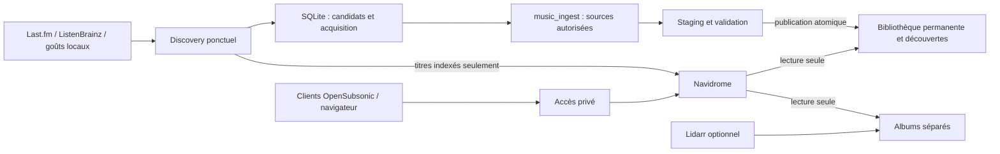

# Architecture Home Music Platform

Le serveur réel est `hp-ubuntu-server`, Ubuntu 24.04.3, i3-5005U, 8 Go.
Le poste de développement Pop!_OS i7/16 Go contient une ancienne stack arrêtée.

Discovery collecte et classe ; `watch` orchestre la liste d'IDs YouTube, les
recommandations hebdomadaires, l'acquisition et les miroirs OpenSubsonic. Ce cycle
est déployé et testé réellement sur le serveur. L'accès privé, les essais iPhone,
la rétention temporaire et Lidarr restent à valider/intégrer ; voir STATUS.

Le worker ponctuel monte `/music` RO et seulement `/music/Managed Singles` RW.
État `/state` et staging `/staging` sont dédiés à l'automatisation. L'adaptateur lit
la SQLite Navidrome avec son WAL en RO pour traduire les chemins virtuels API ;
il n'utilise pour les miroirs que les IDs autorisés et les fichiers existants.
`WATCH_NAVIDROME_DATA` (lecture du catalogue) est distinct de `NAVIDROME_DATA`
(instance parallèle) pour éviter de faire pointer deux serveurs sur la même base.

Le Compose musical est séparé de Servarr vidéo. Navidrome garde comptes, favoris,
écoutes et playlists dans sa SQLite. Les bases ingestion et Discovery restent
indépendantes. Un timer appelle le pipeline sous verrou ; aucun scheduler résident.
Les suggestions indisponibles restent dans SQLite/rapport, jamais dans une playlist
jouable sans ID local vérifié. Les favoris interdisent l'expiration automatique.

La future arborescence logique comporte library, discoveries, downloads/incomplete,
downloads/complete, state, staging, backups et video. Les chemins réels restent
inchangés jusqu'à migration vérifiée (voir AUDIT.md). Les futurs downloads/albums
partageront le même montage `/media` pour permettre les hardlinks. Les sauvegardes
de données personnelles sont ignorées par Git.
